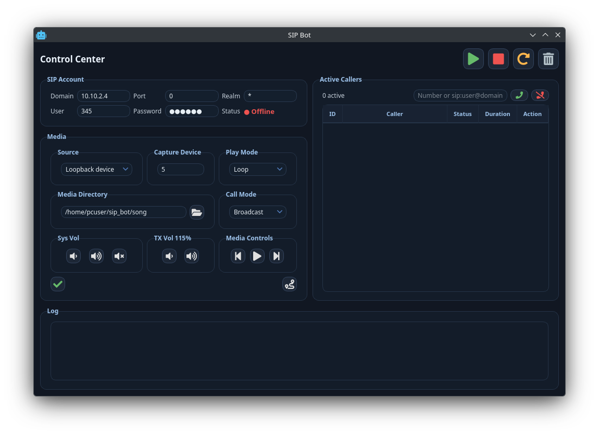

# SIP Bot

SIP-бот с поддержкой видео, аудио и loopback sink для PipeWire/PulseAudio.



## Возможности

- SIP-звонки через PJSUA2
- Воспроизведение аудио через loopback sink
- GUI на PySide6
- Автоматическое создание loopback sink (PipeWire/PulseAudio)
- Десктоп-ярлыки (меню приложений + рабочий стол)
- Глобальное виртуальное окружение (`~/.venv`)

## Быстрый старт

```bash
# Клонировать репозиторий
git clone https://github.com/Voldrix-dev/sip_app.git
cd sip_app

# Запуск (создаст venv, установит зависимости, создаст ярлыки)
./run.sh
```

## Установка PJSUA2

### Ubuntu/Debian
```bash
./pjsua2_setup.sh
```

### Manjaro/Arch
```bash
./pjsua2_setup_manjaro.sh
```

## Постоянный loopback sink

Чтобы sink `sipbot_sink` создавался автоматически при загрузке системы:

```bash
./setup_loopback_sink.sh
```

Скрипт определяет звуковой сервер (PipeWire/PulseAudio), создаёт systemd user service и конфиги.

## Конфигурация

Основные настройки в `data/config.json`:
- `sip_domain`, `sip_user`, `sip_pass` — учётные данные SIP
- `media_source` — источник медиа (`loopback`, `media`, `wav`)
- `wav_dir` — папка с WAV-файлами
- `loopback_sink_name` — имя loopback sink
- `audio_playback_dev`, `audio_capture_dev` — ID аудио-устройств

Пароли лучше хранить в переменных окружения, а не в конфиге.

## Структура проекта

```
sip_app/
├── main.py                    # Точка входа
├── run.sh                     # Лаунчер (venv, deps, shortcuts)
├── setup_loopback_sink.sh     # Установка постоянного loopback sink
├── pjsua2_setup.sh            # Установка PJSUA2 (Ubuntu/Debian)
├── pjsua2_setup_manjaro.sh    # Установка PJSUA2 (Manjaro/Arch)
├── requirements.txt           # Python-зависимости
├── data/
│   ├── config.json           # Конфигурация
│   └── dark.qss              # Тёмная тема
├── gui/
│   ├── window.py             # Главное окно
│   ├── config.py             # Настройки GUI
│   └── bridge.py             # Мост GUI ↔ SIP
├── sipbot/
│   ├── core.py               # Ядро SIP-бота
│   ├── account.py            # SIP-аккаунт
│   ├── call.py               # Звонки
│   ├── audio.py              # Аудио (loopback, media player)
│   └── config.py             # Конфиг аудио
├── icons/                    # Иконки
└── tests/                    # Тесты
```

## Зависимости

- Python 3.10+
- PySide6
- qtawesome
- evdev
- pjsua2 (сборка из исходников)
- ffmpeg
- PipeWire/PulseAudio (pactl)

## Лицензия

MIT